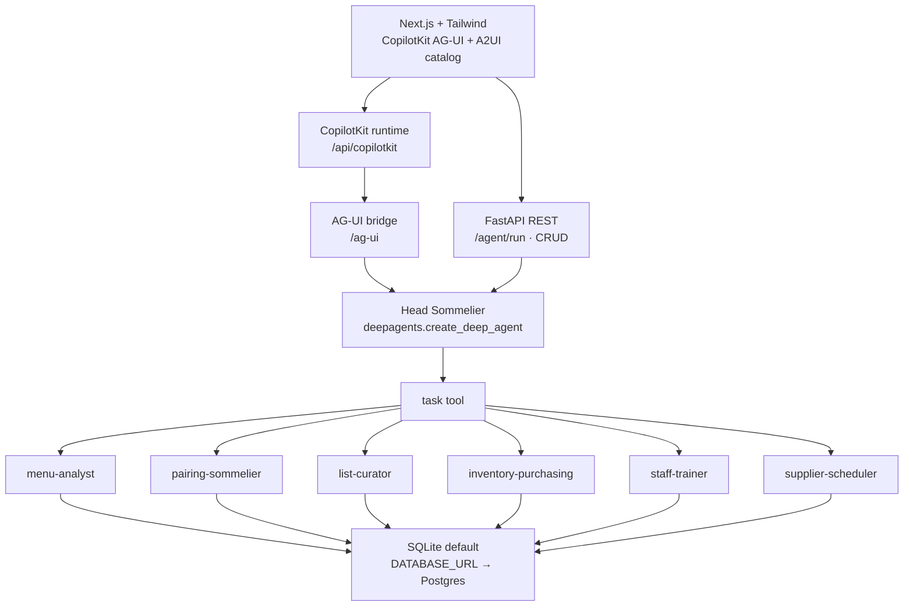

# Madira

Maison Madira's beverage-program desk: a Head Sommelier agent that delegates to specialists and renders **A2UI** surfaces (pairing cards, list tables, inventory, quizzes, tasting drafts) instead of chat walls.

The app is aimed at restaurants. It runs in a clearly labeled **DEMO MODE** with a deterministic fake model when no LLM API key is set.

## Architecture



### Delegation map

The orchestrator never does specialist work. It calls Deep Agents' **`task`** tool with `subagent_type`:

| Subagent | When | A2UI surface |
| --- | --- | --- |
| `menu-analyst` | Menu PDF / image / pasted text | `DishList` |
| `pairing-sommelier` | Pairings per dish (wine, beer, spirit, sake) | `PairingGrid` |
| `list-curator` | Budget + target pour/bottle margin | `BeverageListTable` + `ListSummary` |
| `inventory-purchasing` | Stock, par, depletion, draft POs | `InventoryTable` + `PurchaseOrderTable` |
| `staff-trainer` | Lessons, briefing, quiz, diner roleplay | `LessonCards` + `QuizCard` |
| `supplier-scheduler` | Importer/distributor tastings | `ScheduleForm` + `TastingCalendar` (.ics draft only) |

Delegation is visible in the right-hand rail (active subagent, status, todo list).

## Stack

- **Frontend:** Next.js, TypeScript, Tailwind, CopilotKit (`@copilotkit/react-core`, `@copilotkit/runtime`) over AG-UI, A2UI v0.9 catalog + renderer.
- **Backend:** Python FastAPI, LangChain **Deep Agents** (`deepagents.create_deep_agent`, `subagents=` → `task` tool).
- **Data:** SQLAlchemy. Default `sqlite:///backend/data/madira.db`. Set `DATABASE_URL=postgresql+psycopg://…` for Postgres (same models, no code change).

## Environment

See `.env.example`.

| Variable | Default | Notes |
| --- | --- | --- |
| `MADIRA_LLM_PROVIDER` | `openai` | Also `anthropic`, `google_genai` |
| `MADIRA_LLM_MODEL` | `gpt-4.1-mini` | Provider model id |
| `OPENAI_API_KEY` / `ANTHROPIC_API_KEY` / `GOOGLE_API_KEY` / `MADIRA_API_KEY` | empty | If unset, **DEMO MODE** |
| `MADIRA_DEMO_MODE` | auto | `true` forces fixtures even if a key is saved; `false` requires a key |
| `MADIRA_SECRET_KEY` | dev file | Fernet key (or any secret) for keys saved in Settings. If unset, `backend/data/.madira_secret` is created. Set this in production. |
| `MADIRA_ADMIN_PASSWORD` | unset | Unlocks Settings. If unset, settings reads and writes are refused until you set it and restart. |
| `DATABASE_URL` | sqlite file | Switch to Postgres here |
| `MADIRA_BACKEND_URL` | `http://127.0.0.1:8123` | Used by Next rewrites / CopilotKit HttpAgent |
| `MADIRA_PORT` | `8123` | Backend |
| `GOOGLE_CLIENT_ID` | unset | Google OAuth client id. Sign-in stays disabled until this is set. |
| `GOOGLE_CLIENT_SECRET` | unset | Google OAuth client secret. Backend only. |
| `MADIRA_AUTH_SECRET` | unset | HMAC secret for the sign-in session cookie. |
| `MADIRA_PUBLIC_URL` | unset | Browser origin, no path. Used as the OAuth redirect base. |

Demo mode uses `DemoChatModel`: it inspects the user message, emits `write_todos` + `task` calls, and specialists run deterministic tools against fixtures. No secrets required.

## Settings

Open **Settings** in the nav to leave demo mode without editing a file or restarting.

1. Set `MADIRA_ADMIN_PASSWORD` and restart the backend once. Until that is set, the settings endpoints refuse every read and write with instructions to set it.
2. Unlock the page with that password. The browser sends it once, then keeps a signed token in `sessionStorage` for this tab (8 hours, or until you lock the page or close the tab). The password is not stored.
3. Choose OpenAI, Anthropic, or Google, optionally a model, and paste an API key. The backend sends one 1-token request to that model before saving, so a key with no credits, quota, or permission is rejected. A rejected key is not stored. If a later sommelier run still fails (rate limit, billing, auth), the page shows that provider message. The API key is never included.
4. The key is encrypted with Fernet (`MADIRA_SECRET_KEY`, or the dev fallback file) and the API returns only a hint such as `ends in …abcd`. Saving or removing a key rebuilds the sommelier immediately.

Precedence: a saved key overrides `MADIRA_LLM_PROVIDER`, `MADIRA_LLM_MODEL`, and the provider API keys. Removing it falls back to those environment variables, then to demo mode. `MADIRA_DEMO_MODE=true` still forces demo.

`MADIRA_LLM_VALIDATOR=accept` skips the provider check. Use it only for local tests when you do not have a real key. Do not set it in production.

The Settings end-to-end test needs the running backend to have the same `MADIRA_ADMIN_PASSWORD` as the Playwright process, and `MADIRA_LLM_VALIDATOR=accept` if you are not using a real key.

## Sign in

`/login` offers **Continue with Google**. The rest of the floor, including chat, stays usable while signed out. Google sign-in does not unlock Settings; that still uses `MADIRA_ADMIN_PASSWORD`.

The browser only talks to the Next.js origin. `/madira-api/*` is already rewritten to FastAPI, so the authorization code is exchanged there and the session cookie is first-party (`madira_session`, HttpOnly, SameSite=Lax, Secure when `MADIRA_PUBLIC_URL` is https, 14 days). Sign out is `POST /auth/logout`.

On the first successful sign-in the backend inserts a `users` row (`google_sub` unique, email, name, picture, `created_at`, `last_login_at`). Later sign-ins update that row. The table is created on startup with the other tables (`Base.metadata.create_all`). There is no separate migration tool.

Set these on the **backend** service (Railway's API service, not only `madira-web`):

| Variable | Example |
| --- | --- |
| `GOOGLE_CLIENT_ID` | from Google Cloud |
| `GOOGLE_CLIENT_SECRET` | from Google Cloud |
| `MADIRA_AUTH_SECRET` | long random string |
| `MADIRA_PUBLIC_URL` | `http://localhost:3000` or `https://madira-web-production.up.railway.app` |

`MADIRA_PUBLIC_URL` is the origin only: scheme, host, optional port, no path, no trailing slash. If any of the four is missing, or the public URL is not an origin, `/login` says Google sign-in isn't configured and `/auth/google` redirects back there instead of raising.

In Google Cloud, create an OAuth client of type **Web application**. The consent screen needs the non-sensitive scopes `openid`, `email`, and `profile`. Authorized redirect URIs, exactly:

```text
http://localhost:3000/madira-api/auth/callback
http://127.0.0.1:3000/madira-api/auth/callback
https://madira-web-production.up.railway.app/madira-api/auth/callback
```

`MADIRA_PUBLIC_URL` has to be the origin you are actually browsing. Playwright and `make doctor` use `http://127.0.0.1:3000`, so local sign-in from that host needs `MADIRA_PUBLIC_URL=http://127.0.0.1:3000`. Production:

```text
MADIRA_PUBLIC_URL=https://madira-web-production.up.railway.app
```

The flow is the authorization code grant with S256 PKCE, `state`, and `nonce`. The ID token is checked (RS256 signature against Google's JWKS, issuer, audience, expiry, nonce, `email_verified`) before the user row is written. The cookie is an HMAC of the Google subject, not the Google token.

## Local run

```bash
make install
make dev          # backend :8123 + frontend :3000
```

Or separately: `make backend` and `make frontend`.

One-shot doctor: `make doctor` (expects both processes).

Docker: `docker compose up --build` (backend image + frontend bind-mount).

## Tests

```bash
make test         # Deep Agents wiring: specialists exposed, task delegation, A2UI ops
cd frontend && npx playwright test
```

Project-local verification skill: [`.cursor/skills/verify-madira/SKILL.md`](.cursor/skills/verify-madira/SKILL.md).

## Product

1. **Menu upload** — PDF, image, or paste → dishes → pairings across four beverage types with rationale and price-tier fit.
2. **List curation** — budget + target margin, coverage, gaps, cost/margin math.
3. **Inventory** — on-hand, par, depletion, low-stock, draft POs by supplier (seeded cellar).
4. **Staff training** — wine knowledge, etiquette, daily briefing, scored quiz, diner roleplay.
5. **Supplier meetings** — draft tastings, calendar, `.ics` export. **Never sends email or invites.**
